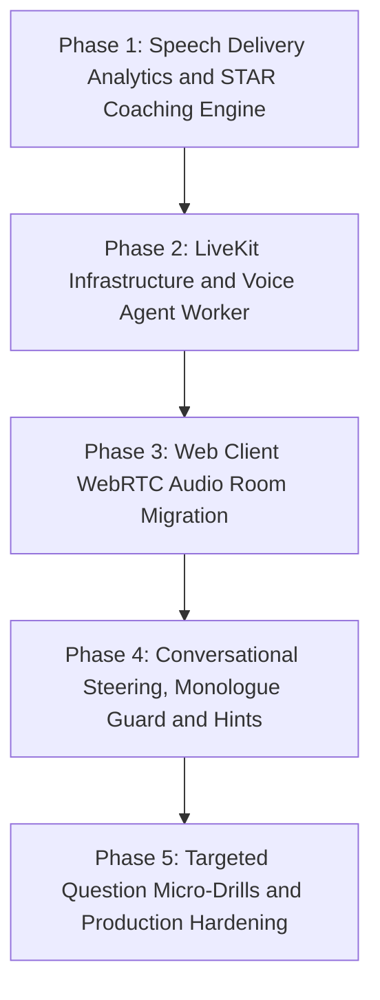

# V1 Building Phases and Implementation Runbook

Version: 1.2  
Status: Active Implementation Runbook  
Tracking Document: [`docs/interview-architecture.md`](./interview-architecture.md)  

---

# Purpose and Philosophy

This runbook defines the step-by-step phased execution plan to upgrade Interviewer AI into an **audio-first, human-parity interview platform**.

Instead of attempting a risky, monolithic rewrite, the upgrade is divided into **5 sequential, independently shippable, and backward-compatible phases**. Each phase follows an engineering standard where every assumption is checked before coding, every task defines concrete inputs, outputs, formulas, and edge cases, and every acceptance check provides an exact, falsifiable verification procedure.



---

## Phase 1: Speech Delivery Analytics and Exemplar Coaching Engine

### Objective
Deliver immediate pedagogical value using the existing voice pipeline by upgrading post-interview evaluations to provide actionable speech delivery metrics (pacing, filler words, talk-to-listen ratio, response latency) and structured STAR method breakdowns with senior-level exemplar responses.

### Out of Scope
- Modifying media transport or WebSocket connections (WebRTC transport belongs in Phases 2 and 3).
- Adding live audio recording or storing raw audio bytes (violates privacy architecture).
- Modifying live conversation turn-taking, interview plan generation, or billing tiers.
- Adding third-party audio processing libraries to `apps/api`.
- Adding `metadata` column to `ConversationTurn` (strictly deferred to Phase 4).

### Task 0: Assumption check
The executing agent verifies the following confirmed decisions against the repository before coding:
1. **Turn Timestamps and Duration in Database (Decided)**:
   * A Prisma migration is required in Phase 1.
   * Add the following nullable columns to `model ConversationTurn` in `apps/api/prisma/schema.prisma`:
     * `startedAt DateTime?`
     * `endedAt DateTime?`
     * `durationMs Int?` (recorded for both candidate and agent turns)
     * `words Json?` (nullable JSON array for word-level timing offsets from Deepgram)
   * **Rule**: Never derive turn duration from `createdAt`.
   * **Rule**: When timing columns are null (all legacy data and non-voice turns), analytics functions must return `null` so old reports continue to load without errors.
2. **Prompt File Paths (Decided)**:
   * The actual file in the codebase is `packages/prompts/src/report.ts` (singular), re-exported through `packages/prompts/src/index.ts`.
3. **Report Schema Compatibility (Decided)**:
   * `packages/types/src/index.ts` must extend `interviewReportSchema` and `interviewEvaluationSchema` with optional fields (`speechDelivery`, `starBreakdown`, `exemplars`). Existing records in PostgreSQL deserialize cleanly when these fields are omitted.
4. **LLM Provider Structured Outputs (Decided)**:
   * The Gemini 2.0 Flash structured output schema in `apps/api/src/modules/ai/adapters/` must strictly require all defined sub-keys while allowing non-behavioral interviews to omit STAR evaluations.

### Tasks
* [ ] **Task 1.1 — Word Timestamp and Cadence Analytics Module**
  * Exact File: `apps/api/src/modules/reports/speech-analytics.ts`.
  * Public Function: `calculateSpeechDeliveryMetrics(input: SpeechAnalyticsInput): SpeechDeliveryMetrics`.
  * Input Type:
    ```typescript
    export type WordTimingEntry = {
      word: string;
      start: number;
      end: number;
      confidence?: number;
    };

    export type TurnTimingInput = {
      id: string;
      speaker: "USER" | "AI" | "SYSTEM";
      text: string;
      createdAt: Date;
      startedAt: Date | null;
      endedAt: Date | null;
      durationMs: number | null;
      words: WordTimingEntry[] | null;
    };

    export type SpeechAnalyticsInput = {
      turns: TurnTimingInput[];
    };
    ```
  * Output Type:
    ```typescript
    export type SpeechDeliveryMetrics = {
      overallWpm: number | null;
      turnWpm: Array<{ turnId: string; wpm: number | null }>;
      fillerWordCounts: Record<string, number>;
      totalFillerWords: number;
      talkRatio: {
        candidateDurationMs: number;
        interviewerDurationMs: number;
        candidatePercentage: number;
      };
      averageResponseLatencyMs: number | null;
    };
    ```
  * Mathematical Formulas:
    * **Words Per Minute (WPM)** per turn:
      * Word count: If `words` array is present and non-empty, use `words.length`. Otherwise, count non-empty tokens from `text.trim().split(/\s+/)`.
      * Duration: Use `turn.durationMs`. Do not derive from `createdAt`.
      * Formula:
        $$\text{WPM} = \frac{\text{Word Count} \times 60000}{\text{durationMs}}$$
      * If `durationMs == null` or `durationMs <= 0`: set `wpm` to `null`.
    * **Overall WPM**:
      * Sum total candidate words across all candidate (`USER`) turns where `durationMs > 0`.
      * Sum total candidate `durationMs` across qualifying candidate turns.
      * Overall WPM = $\frac{\text{Total Candidate Words} \times 60000}{\text{Total Candidate Duration Ms}}$.
      * If total candidate duration is null or 0, return `null`.
    * **Filler Word Count**: Canonical case-insensitive regex:
      `/\b(um|uh|like|you know|sort of|kind of|basically|actually)\b/gi`
      Count occurrences per canonical normalized key across all candidate turns.
    * **Talk-to-Listen Ratio**:
      * Sum `candidateDurationMs` across candidate turns with non-null `durationMs`.
      * Sum `interviewerDurationMs` across AI turns with non-null `durationMs`.
      * If both durations are 0 or null, set `candidatePercentage: 0`.
      * Otherwise:
        $$\text{candidatePercentage} = \frac{\text{candidateDurationMs}}{\text{candidateDurationMs} + \text{interviewerDurationMs}} \times 100$$
    * **Latency-to-Respond**:
      * For each candidate (`USER`) turn immediately preceded by an `AI` turn:
      * If `candidate.startedAt` is present and preceding `ai.endedAt` is present:
        $$\text{Pause} = \max(0, \text{candidate.startedAt.getTime()} - \text{ai.endedAt.getTime()})$$
      * Average Latency = sum of pauses divided by count of qualifying pairs. If no qualifying pairs exist, return `null`.
  * Edge Cases:
    * `durationMs == null` or `durationMs <= 0`: Return `wpm: null` (never divide by zero or emit `Infinity`/`NaN`).
    * Empty transcript or `turns: []`: Return `overallWpm: null`, `turnWpm: []`, `fillerWordCounts: {}`, `totalFillerWords: 0`, `talkRatio: { candidateDurationMs: 0, interviewerDurationMs: 0, candidatePercentage: 0 }`, `averageResponseLatencyMs: null`.
    * Candidate word count is 0 with valid duration $> 0$: Set `wpm: 0`.
    * Missing timestamps for latency calculation: Omit pair from average; return `null` if no valid pairs exist.
  * Backward Compatibility:
    * Historical turns have null `durationMs`, `startedAt`, `endedAt`, and `words`. Analytics must return `null` for all duration-dependent fields without throwing exceptions.

* [ ] **Task 1.2 — STAR Method and Exemplar Prompt Engineering**
  * Exact Files: `packages/prompts/src/report.ts`, `packages/prompts/src/evaluation.ts`, and `packages/prompts/src/index.ts`.
  * Update `buildEvaluationPrompt()` and `buildReportPrompt()`:
    * Instruct the evaluation LLM to analyze candidate answers for behavioral questions using Situation, Task, Action, and Result (STAR).
    * Require sub-scores (0–100) and evidence turn references for each STAR component.
    * Require detection of "we" vs. "I" personal ownership language in the Action component.
    * For any candidate answer whose overall evaluation or dimension score is $< 70/100$, generate a Staff/Principal-level model exemplar response demonstrating structured delivery, quantified impact metrics, and active ownership.
  * Backward Compatibility: Technical questions without behavioral context must allow empty or optional `starBreakdown` without causing evaluation schema rejections.

* [ ] **Task 1.3 — Schema and Database Contract Updates**
  * Exact Files: `apps/api/prisma/schema.prisma`, `packages/types/src/index.ts`, `apps/api/src/modules/reports/schema.ts`.
  * Database Migration:
    * Generate Prisma migration in `apps/api/prisma/migrations/`:
      ```prisma
      // In model ConversationTurn:
      startedAt  DateTime?
      endedAt    DateTime?
      durationMs Int?
      words      Json?
      ```
  * Schema Extensions in `packages/types/src/index.ts`:
    ```typescript
    export const starComponentSchema = z.object({
      score: z.number().min(0).max(100),
      feedback: z.string().trim().min(1).max(1000),
      evidenceTurnIds: z.array(z.uuid()).max(5),
    });

    export const starBreakdownSchema = z.object({
      situation: starComponentSchema,
      task: starComponentSchema,
      action: starComponentSchema,
      result: starComponentSchema,
    });

    export const questionExemplarSchema = z.object({
      turnId: z.uuid(),
      questionText: z.string().trim().min(1),
      candidateAnswerSnippet: z.string().trim().min(1),
      candidateScore: z.number().min(0).max(100),
      exemplarResponse: z.string().trim().min(1).max(3000),
      improvementRationale: z.string().trim().min(1).max(1000),
    });

    export const speechDeliverySchema = z.object({
      overallWpm: z.number().nullable(),
      fillerWordCounts: z.record(z.string(), z.number()),
      totalFillerWords: z.number().int().nonnegative(),
      talkRatio: z.object({
        candidateDurationMs: z.number().nonnegative(),
        interviewerDurationMs: z.number().nonnegative(),
        candidatePercentage: z.number().min(0).max(100),
      }),
      averageResponseLatencyMs: z.number().nullable(),
    });
    ```
  * Add optional fields to `interviewEvaluationSchema`:
    * `speechDelivery: speechDeliverySchema.optional()`
    * `starBreakdown: z.record(z.string(), starBreakdownSchema).optional()`
    * `exemplars: z.array(questionExemplarSchema).optional()`
  * Ensure existing records in PostgreSQL deserialize cleanly when optional fields are omitted.

* [ ] **Task 1.4 — Frontend Report UI Enhancements**
  * Exact Files: `apps/web/features/reports/components/report-review.tsx`, `apps/web/features/reports/components/speech-delivery-card.tsx`, `apps/web/features/reports/components/exemplar-card.tsx`.
  * Create `SpeechDeliveryCard`:
    * WPM Gauge with color coding:
      * Slow: $< 120$ WPM (text-amber-500)
      * Below Target (proposed): $120$ to $129$ WPM (text-amber-400)
      * Ideal: $130$ to $160$ WPM (text-emerald-500)
      * Above Target (proposed): $161$ to $170$ WPM (text-amber-400)
      * Fast: $> 170$ WPM (text-rose-500)
      * Null: Display "N/A — timing data unavailable"
    * Filler word frequency breakdown: badges sorted descending by frequency (`like`, `um`, `uh`, `basically`, `you know`).
    * Talk-to-listen percentage progress bar showing candidate % vs. interviewer %.
    * Response latency indicator showing average seconds before answer onset.
  * Create `ExemplarComparisonCard`:
    * Renders side-by-side on desktop ($\ge 1024$px) and stacked on mobile ($< 1024$px).
    * Shows "What You Said" alongside "Staff-Level Exemplar Response" with improvement rationale.
    * Rendered only for questions scoring $< 70\%$.

### Acceptance Checks
1. Speech analytics calculation accuracy:
   * Command: `pnpm --filter @interviewer-ai/api test apps/api/src/tests/speech-analytics.test.ts`
   * Fixture input: Turn duration 60,000 ms, word count 180 words, text containing 14 "like", 4 "um", 2 "basically".
   * Expected output: `overallWpm` equals 180, `totalFillerWords` equals 20, `fillerWordCounts.like` equals 14, `fillerWordCounts.um` equals 4, `fillerWordCounts.basically` equals 2.
2. Analytics missing timing / edge case verification:
   * Command: `pnpm --filter @interviewer-ai/api test apps/api/src/tests/speech-analytics-edge-cases.test.ts`
   * Fixture inputs:
     a) `durationMs = null`, words = 50 yields `overallWpm` is `null`.
     b) `durationMs = 0`, words = 50 yields `overallWpm` is `null`.
     c) `text = ""`, `durationMs = 45000` yields `overallWpm` is 0.
     d) `turns = []` yields all metrics return null or zero without throwing errors.
     e) Verify that duration is not computed from `createdAt`.
3. Database migration and legacy report parsing:
   * Command: `pnpm --filter @interviewer-ai/api prisma migrate status && pnpm --filter @interviewer-ai/types test`
   * Procedure: Verify Prisma migration applied; parse legacy report fixture lacking `speechDelivery`, `starBreakdown`, and `exemplars` using `interviewReportSchema.parse`.
   * Expected output: Migration status is up to date; schema validation succeeds with return object intact.
4. Schema and mock evaluation test:
   * Command: `pnpm --filter @interviewer-ai/api test apps/api/src/tests/report-service.test.ts`
   * Procedure: Mock `AiProvider` returning a complete report with STAR sub-scores and an exemplar for a score 62 answer; execute `ReportService.generate(interviewId)`.
   * Expected output: Report is saved with status `READY`, and persisted JSON includes `speechDelivery`, `starBreakdown`, and `exemplars`.
5. Frontend UI responsive checks:
   * Viewports: Mobile (375px), Tablet (768px), Desktop (1280px).
   * Procedure: Load completed report page containing speech delivery metrics and exemplar card; take screenshots at each viewport.
   * Expected output:
     a) 375px: WPM gauge and talk ratio fit screen without horizontal overflow; exemplar card displays stacked view.
     b) 768px: Grid columns wrap cleanly; filler badges wrap within card.
     c) 1280px: Speech delivery metrics display in three-column metric row; exemplar card renders side-by-side comparison.
6. Baseline sanity:
   * Command: `pnpm typecheck && pnpm test`
   * Expected output: 0 TypeScript errors, all unit and integration test suites pass.

### Definition of Done
All 6 acceptance checks pass with exact output shown, no code outside Phase 1 scope is modified, and a "Phase 1 status: done" note is appended to the tracker table in this file.

---

## Phase 2: LiveKit Infrastructure and Voice Agent Worker

### Objective
Deploy the LiveKit SFU media server in the local Docker environment under a compose profile, establish the autonomous voice agent worker in `apps/agent` using `@livekit/agents` with Deepgram Aura-2 as the default TTS, and implement Fastify token minting and internal state synchronization with constant-time secret validation.

### Out of Scope
- Modifying browser frontend audio plumbing to WebRTC (belongs strictly in Phase 3).
- Conversational steering policies such as monologue interjection and hints (belongs in Phase 4).
- Targeted micro-drills (belongs in Phase 5).
- Modifying billing webhooks or database user authentication.
- Creating an `infrastructure/docker-compose.yml` file.

### Task 0: Assumption check
The executing agent verifies the following confirmed decisions against the repository before coding:
1. **Docker Compose Location and Profile (Decided)**:
   * LiveKit SFU must be added to the existing root `docker-compose.yml` under a compose profile (`profiles: ["livekit"]`).
   * Do NOT create `infrastructure/docker-compose.yml`.
2. **Environment Variable Configuration (Decided)**:
   * In `packages/config/src/index.ts` and `.env.example`:
     * Add `LIVEKIT_URL` (default: `"ws://localhost:7880"`).
     * Add `LIVEKIT_API_KEY` (default: `"devkey"`).
     * Add `LIVEKIT_API_SECRET` (default: `"secret"`).
     * Add `CARTESIA_API_KEY` as optional (empty/undefined by default).
     * Add `INTERNAL_API_SECRET`: Required at startup in Fastify API. Fails startup in production if missing.
3. **TTS Default and Fallback (Decided)**:
   * Deepgram Aura-2 is the default TTS provider.
   * When `CARTESIA_API_KEY` is configured in the environment, the agent worker uses Cartesia Sonic with fallback to Deepgram Aura-2.
4. **Internal Route Security (Decided)**:
   * `POST /api/v1/internal/interviews/:id/turns` authenticates using header `x-internal-secret`.
   * Validation requires constant-time string comparison (`crypto.timingSafeEqual`) to prevent timing attacks.
   * API startup verifies `INTERNAL_API_SECRET` is set and non-empty.

### Tasks
* [ ] **Task 2.1 — LiveKit SFU Deployment and Config**
  * Exact Files: `docker-compose.yml`, `packages/config/src/index.ts`, `.env.example`.
  * Add `livekit` service to the existing root `docker-compose.yml` under profile `livekit`:
    ```yaml
    livekit:
      image: livekit/livekit-server:v1.8.3
      command: --dev --bind 0.0.0.0
      profiles: ["livekit"]
      ports:
        - "7880:7880"
        - "7881:7881"
        - "7882:7882/udp"
      environment:
        - LIVEKIT_KEYS=devkey: secret
    ```
  * In `packages/config/src/index.ts`, add to `serverEnvironmentSchema`:
    * `LIVEKIT_URL: z.string().url().default("ws://localhost:7880")`
    * `LIVEKIT_API_KEY: optionalEnvironmentString.default("devkey")`
    * `LIVEKIT_API_SECRET: optionalEnvironmentString.default("secret")`
    * `CARTESIA_API_KEY: optionalEnvironmentString`
    * `INTERNAL_API_SECRET: z.string().min(16).default("dev-internal-secret-min-16-chars")`
  * Add superRefine check: In production (`NODE_ENV === "production"`), `INTERNAL_API_SECRET` must not equal the development default.
  * Mirror all variables in `.env.example`.

* [ ] **Task 2.2 — Fastify Token Minting Endpoint**
  * Exact Files: `apps/api/src/modules/conversation/controller.ts`, `apps/api/src/modules/conversation/service.ts`, `apps/api/package.json`.
  * Install dependency: `livekit-server-sdk` in `apps/api/package.json`.
  * Route: `POST /api/v1/interviews/:id/livekit-token`.
  * Auth: Authenticated, verified user via `app.requireVerifiedUser`.
  * Validation:
    * Interview must exist and belong to authenticated `userId`.
    * Interview lifecycle status must be `READY` or `IN_PROGRESS`.
    * If status is `DRAFT`, `COMPLETING`, `COMPLETED`, or `FAILED`, return HTTP 409 `INVALID_STATE_TRANSITION`.
  * Token Minting:
    * Construct `AccessToken` with `LIVEKIT_API_KEY` and `LIVEKIT_API_SECRET`.
    * Set identity to `user-${userId}`.
    * Set room name to `interview-${id}`.
    * Grant permissions: `roomJoin: true`, `canPublish: true`, `canSubscribe: true`, `canPublishData: true`.
    * Set token TTL to 3600 seconds (proposed).
  * Response Shape:
    ```json
    {
      "token": "<jwt-token-string>",
      "url": "ws://localhost:7880",
      "roomName": "interview-<id>",
      "participantIdentity": "user-<userId>"
    }
    ```

* [ ] **Task 2.3 — Autonomous Voice Agent Worker (`apps/agent`)**
  * Exact Files: `apps/agent/package.json`, `apps/agent/tsconfig.json`, `apps/agent/src/index.ts`, `apps/agent/src/agent.ts`.
  * Package Setup: Initialize `@interviewer-ai/agent` using Node.js 22 LTS with dependencies `@livekit/agents`, `@livekit/agents-plugin-silero`, `@livekit/agents-plugin-deepgram`, `@livekit/agents-plugin-cartesia`.
  * Pipeline Configuration:
    * **VAD**: Silero VAD configured for conversational turn boundaries (`minSpeechDuration: 0.2`, `minSilenceDuration: 0.6`).
    * **STT**: Deepgram Nova-3 streaming transcriber (`model: "nova-3"`, `language: interviewLanguage`).
    * **LLM**: Gemini 2.0 Flash loaded with prompt instruction from `@interviewer-ai/prompts` (`buildAgentInterviewInstruction`).
    * **TTS**: Default is Deepgram Aura-2 (`model: "aura-asteria-en"`). If `CARTESIA_API_KEY` is present, use Cartesia Sonic (`model: "sonic-english"`) with automatic fallback to Deepgram Aura-2.
  * Worker Behavior: Connects to LiveKit SFU, registers job dispatch listener on rooms starting with `interview-`, and emits opening greeting upon candidate participant connection.

* [ ] **Task 2.4 — Internal State Synchronization Bridge**
  * Exact Files: `apps/api/src/modules/conversation/controller.ts`, `apps/api/src/modules/conversation/service.ts`, `apps/api/src/modules/conversation/schema.ts`.
  * Route: `POST /api/v1/internal/interviews/:id/turns`.
  * Security:
    * Fastify startup checks that `INTERNAL_API_SECRET` is non-empty.
    * Validate incoming `x-internal-secret` using constant-time string comparison (`crypto.timingSafeEqual`).
    * Reject with HTTP 401 if header is missing, length mismatch, or value invalid.
  * Input Schema:
    ```typescript
    export const internalTurnSyncSchema = z.object({
      speaker: z.enum(["USER", "AI", "SYSTEM"]),
      type: conversationTurnTypeSchema,
      text: z.string().trim().min(1),
      startedAt: z.string().datetime().optional(),
      endedAt: z.string().datetime().optional(),
      durationMs: z.number().int().nonnegative().optional(),
      words: z
        .array(
          z.object({
            word: z.string(),
            start: z.number(),
            end: z.number(),
            confidence: z.number().optional(),
          }),
        )
        .optional(),
    });
    ```
  * Execution:
    * Atomically appends `ConversationTurn` with timing columns in PostgreSQL transaction.
    * When an AI turn completes (`speaker: "AI"`), updates `InterviewMemory` (`askedQuestions`, `topicCoverage`).
    * Publishes `TranscriptFinalized` or `AIResponseGenerated` onto Redis `RealtimeEventBus`.
    * Returns HTTP 201 with created `ConversationTurnDto`.

### Acceptance Checks
1. LiveKit SFU startup with compose profile:
   * Command: `docker compose --profile livekit up -d livekit && curl -I http://localhost:7880`
   * Expected output: LiveKit container boots cleanly and returns HTTP 200 OK.
2. Fastify LiveKit token endpoint validation:
   * Command: `pnpm --filter @interviewer-ai/api test apps/api/src/tests/livekit-token.test.ts`
   * Test cases:
     a) Anonymous request yields HTTP 401 UNAUTHORIZED.
     b) User with `READY` interview yields HTTP 200 with valid JWT string, `url`, and `roomName`.
     c) Validates decoded JWT claims: `video.roomJoin === true`, `video.room === "interview-<id>"`.
     d) User with `COMPLETED` interview yields HTTP 409 INVALID_STATE_TRANSITION.
3. Internal sync bridge constant-time security and persistence:
   * Command: `pnpm --filter @interviewer-ai/api test apps/api/src/tests/internal-sync.test.ts`
   * Test cases:
     a) Missing or invalid `x-internal-secret` header yields HTTP 401 UNAUTHORIZED.
     b) Timing attack check: verifies `crypto.timingSafeEqual` is used for token evaluation.
     c) Valid secret and payload yields HTTP 201 CREATED; verify row exists in `conversation_turn` table with `durationMs`, `startedAt`, `endedAt`, `words` persisted.
4. Agent worker dispatch connection and default Aura-2 TTS:
   * Command: `pnpm --filter @interviewer-ai/agent test`
   * Procedure: Harness runs agent worker against test room without `CARTESIA_API_KEY`; verifies worker receives job, joins room, uses Deepgram Aura-2, and executes greeting dispatch.
5. Cartesia optional TTS activation:
   * Procedure: Run agent test with `CARTESIA_API_KEY="test-cartesia-key"`; verify worker initializes Cartesia Sonic with Deepgram fallback.
6. Baseline sanity:
   * Command: `pnpm typecheck && pnpm test`
   * Expected output: 0 TypeScript errors across all workspaces, all tests pass.

### Definition of Done
All 6 acceptance checks pass with exact output shown, no code outside Phase 2 scope is modified, and a "Phase 2 status: done" note is appended to the tracker table in this file.

---

## Phase 3: Web Client WebRTC Audio Room Migration

### Objective
Migrate the browser frontend from legacy raw PCM WebSockets to LiveKit WebRTC using `@livekit/components-react`, enabling hardware-accelerated Acoustic Echo Cancellation (AEC) and smooth 3D voice orb audio reactivity.

### Out of Scope
- Backend scoring, evaluation reports, or rubric changes (Phase 1).
- Conversational steering policies and hint engines (Phase 4).
- Single-question micro-drills (Phase 5).
- Removing the emergency text-mode fallback composer.

### Task 0: Assumption check
The executing agent verifies the following confirmed decisions against the repository before coding:
1. **Installed Web Dependencies**: Check `apps/web/package.json`. `@livekit/components-react` and `livekit-client` must be added.
2. **Web Connection URL**: The client will connect using the server `url` returned directly by `POST /api/v1/interviews/:id/livekit-token` rather than relying on a separate static client-side URL.
3. **Autoplay User Gesture**: Room connection must be initiated by an explicit candidate click on "Start Voice Interview" to unlock browser audio output.
4. **Three.js Visualizer Integration**: `apps/web/features/conversation/components/voice-visualizer.tsx` will be adapted to read audio track energy from LiveKit's `useTrackVolume` hook for candidate and agent audio streams.

### Tasks
* [ ] **Task 3.1 — Install and Configure LiveKit Web SDK**
  * Exact Files: `apps/web/package.json`, `apps/web/features/conversation/components/livekit-audio-room.tsx`.
  * Install dependencies: `@livekit/components-react` and `livekit-client` in `apps/web/package.json`.
  * Create `LiveKitAudioRoom`:
    * Props:
      ```typescript
      type LiveKitAudioRoomProps = {
        interviewId: string;
        token: string;
        serverUrl: string;
        onConnected: () => void;
        onDisconnected: () => void;
        onError: (error: Error) => void;
        children: React.ReactNode;
      };
      ```
    * Wraps session with `<LiveKitRoom audio={true} video={false} connect={true}>`.
    * Mounts `<RoomAudioRenderer />` to handle incoming audio tracks from the agent worker.

* [ ] **Task 3.2 — Replace Raw PCM Plumbing**
  * Exact Files: `apps/web/features/conversation/agent-voice.ts`, `apps/web/features/conversation/components/microphone.tsx`, `apps/web/app/(app)/interviews/[id]/page.tsx`.
  * Mark `AgentMicCapture` (`ScriptProcessorNode`) and `AgentAudioPlayer` in `agent-voice.ts` as deprecated.
  * Publish candidate microphone track with hardware-accelerated constraints:
    ```typescript
    const audioTrackConstraints: MediaTrackConstraints = {
      echoCancellation: true,
      noiseSuppression: true,
      autoGainControl: true,
      channelCount: 1,
      sampleRate: 48000,
    };
    ```
  * Maintain graceful fallback: if WebRTC room fails to connect within 10 seconds (proposed), show a fallback alert enabling one-click switch to typed text mode.

* [ ] **Task 3.3 — Connect Voice Orb and Visualizer to WebRTC Audio Energy**
  * Exact Files: `apps/web/features/conversation/components/voice-visualizer.tsx`, `apps/web/features/conversation/components/livekit-visualizer-adapter.tsx`.
  * Create `LiveKitVisualizerAdapter`:
    * Subscribes to local candidate audio track using `useTrackVolume(localTrack)`.
    * Subscribes to remote agent audio track using `useTrackVolume(remoteTrack)`.
    * Maps normalized volume (0.0 to 1.0) into Three.js vertex distortion and sphere scaling.
  * State Animations:
    * `LISTENING`: Gentle idle breathing oscillation (base scale 1.0, subtle periodic pulse).
    * `THINKING`: Concentrated orbital particle swirl (higher rotation velocity, reduced radial displacement).
    * `SPEAKING`: Dynamic amplitude reactivity responding directly to the agent's synthesized voice energy (scaling up to 1.35 based on volume).

* [ ] **Task 3.4 — HUD Controls and Failure Fallback**
  * Exact Files: `apps/web/app/(app)/interviews/[id]/page.tsx`.
  * Retain and connect interview HUD controls:
    * Authoritative interview duration countdown timer.
    * Microphone mute/unmute button calling `localTrack.mute()` and `localTrack.unmute()`.
    * End interview confirmation button calling `POST /api/v1/interviews/:id/conversation/complete`.
    * WebRTC connection health badge: "Connected" (emerald), "Reconnecting" (amber), "Disconnected" (rose).
    * "Switch to text mode" emergency toggle: unmounts LiveKit room and switches interaction mode to `TEXT`.

### Acceptance Checks
1. WebRTC client component mount and connection test:
   * Command: `pnpm --filter @interviewer-ai/web test apps/web/features/conversation/components/livekit-audio-room.test.tsx`
   * Procedure: Mock LiveKit client room with connected room state; verify `<LiveKitRoom>` mounts, enables audio, and invokes `onConnected`.
2. Audio track constraints verification:
   * Procedure: Test track publishing invocation asserting `echoCancellation === true`, `noiseSuppression === true`, and `autoGainControl === true`.
3. 3D visualizer state mapping test:
   * Command: `pnpm --filter @interviewer-ai/web test apps/web/features/conversation/components/voice-visualizer.test.tsx`
   * Test cases: Verify visualizer scale and rotation parameters across `LISTENING`, `THINKING`, and `SPEAKING` states.
4. Reconnection and text mode fallback test:
   * Procedure: Simulate WebRTC room disconnection in test harness; verify UI displays "Reconnecting..." state and offers "Switch to text mode" button that successfully activates the text composer.
5. Responsive UI visual check:
   * Viewports: Mobile (375px), Tablet (768px), Desktop (1280px).
   * Procedure: Render live interview room in connected state; take screenshots at each viewport.
   * Expected output:
     a) 375px: 3D orb centered, timer and controls docked cleanly in bottom HUD bar without obscuring visualizer.
     b) 768px: Balanced HUD layout with transcript toggle accessible.
     c) 1280px: Full desktop view with side-by-side or overlaid transcript panel, mute button, and end interview button.
6. Baseline sanity:
   * Command: `pnpm typecheck && pnpm test`
   * Expected output: 0 TypeScript errors, all unit and component tests pass.

### Definition of Done
All 6 acceptance checks pass with exact output shown, no code outside Phase 3 scope is modified, and a "Phase 3 status: done" note is appended to the tracker table in this file.

---

## Phase 4: Conversational Steering, Monologue Guard and Hints

### Objective
Empower the autonomous voice interviewer to actively guide conversations by cutting in politely on candidate monologues exceeding 90 seconds, providing calibrated single-sentence hints upon candidate request, and executing the three-strike silence ladder in the LiveKit agent worker.

### Out of Scope
- Modifying LiveKit SFU infrastructure or Docker container ports (Phase 2).
- Modifying post-interview report UI or visualizer components (Phase 1, Phase 3).
- Adding multi-question micro-drills (Phase 5).
- Modifying billing or entitlement tiers.
- Modifying `InterviewMemory` for hint tracking.

### Task 0: Assumption check
The executing agent verifies the following confirmed decisions against the repository before coding:
1. **Turn Metadata Migration (Decided)**:
   * Add `metadata Json?` to `model ConversationTurn` in a dedicated Phase 4 migration (not Phase 1).
   * In application code, treat null `metadata` as `{}`.
   * **Rule**: Store hints directly in `ConversationTurn.metadata` (e.g. `{ hintProvided: true }`). Do NOT store hints in `InterviewMemory`.
   * **Rule**: Store monologue interruption flags in `ConversationTurn.metadata` (e.g. `{ steeredReason: "MONOLOGUE_LIMIT_EXCEEDED" }`).
2. **Silence Ladder Timings (Decided)**:
   * Unify silence ladder on the 10s / 18s / 26s sequence:
     * Strike 1 at 10s idle.
     * Strike 2 at +8s idle (18s total).
     * Strike 3 (Move-on) at +8s idle (26s total).

### Tasks
* [ ] **Task 4.1 — Active Monologue Interruption Engine**
  * Exact Files: `apps/agent/src/monologue-guard.ts`, `apps/agent/src/agent.ts`.
  * Speech Onset Watchdog:
    * Track candidate speech onset time when VAD transitions to `SPEECH_STARTED`.
    * If candidate speech continues for $> 90$ seconds without an uninterrupted pause of $\ge 2.0$ seconds (proposed):
      * Trigger an immediate conversational steer.
      * Halt candidate audio listening stream and begin TTS playback.
      * Spoken interjection copy:
        *"Excuse me for stepping in—I want to make sure we have time for the key trade-offs. Could you highlight the main architectural decision here?"*
      * Sync turn to backend via internal bridge with `type: "FOLLOW_UP"` and metadata `{ steeredReason: "MONOLOGUE_LIMIT_EXCEEDED" }`.
    * Edge Cases: If candidate pauses for $\ge 2.0$ seconds before 90s, reset the monologue timer.

* [ ] **Task 4.2 — Calibrated Hint Protocol and Metadata Migration**
  * Exact Files: `apps/api/prisma/schema.prisma`, `packages/prompts/src/agent.ts`, `apps/agent/src/agent.ts`, `apps/api/src/modules/reports/service.ts`.
  * Database Migration:
    * Generate Prisma migration in `apps/api/prisma/migrations/`:
      ```prisma
      // In model ConversationTurn:
      metadata Json?
      ```
    * Application reading handles `metadata ?? {}`.
  * Update system prompt in `packages/prompts/src/agent.ts`:
    * Recognize explicit candidate requests for hints (*"Can I get a hint?"*, *"I am stuck"*, *"Could you point me in the right direction?"*).
    * Instruct the model to provide a single-sentence conceptual clue that points toward the trade-off or concept without disclosing the full solution.
    * Tag the turn with `{ hintProvided: true }` in `metadata`. Do not write to `InterviewMemory`.
  * Update `apps/api/src/modules/reports/service.ts`:
    * Factor hint frequency into rubric scoring for the `problemSolving` dimension.
    * Formula (proposed):
      $$\text{Hint Penalty} = \min(20, \text{hintCount} \times 5)$$
      $$\text{adjustedProblemSolvingScore} = \max(0, \text{rawProblemSolvingScore} - \text{Hint Penalty})$$
    * Reflect hint occurrences in the report summary findings.

* [ ] **Task 4.3 — Silence Ladder Port to LiveKit Agent**
  * Exact Files: `apps/agent/src/silence-watchdog.ts`, `apps/agent/src/agent.ts`.
  * Port three-strike silence policy from `apps/api/src/modules/conversation/silence-ladder.ts` into agent worker:
    * Watchdog is armed when agent finishes speaking (`AgentAudioDone`) and transitions to `LISTENING`.
    * **Strike 1 (10s idle)**: Inject and speak canned reassurance:
      *"Take your time — I'm here whenever you're ready."*
    * **Strike 2 (+8s idle, 18s total)**: Inject and speak canned offer:
      *"No rush at all. Would you like to pause here, or shall we move to the next question?"*
    * **Strike 3 (+8s idle, 26s total — Move-on)**:
      * Advances interview plan to next topic.
      * Appends unanswered question to `InterviewMemory.weakAreas`.
      * Speaks transition statement: *"Let's move ahead to our next topic."*
    * **Graceful Completion**: If move-on count reaches 3 or interview duration cap is reached, speak closing statement and invoke `POST /api/v1/interviews/:id/conversation/complete`.
    * **Disarm**: Candidate speech onset (`VAD speech_started`) immediately disarms pending silence timers.

### Acceptance Checks
1. Monologue interruption simulation test:
   * Command: `pnpm --filter @interviewer-ai/agent test apps/agent/src/tests/monologue-guard.test.ts`
   * Input fixture: Synthetic candidate audio stream lasting 95 seconds without a 2.0s pause.
   * Expected output: At $t = 90$s, monologue guard triggers; agent halts listening, begins speaking the conversational steer, and records `MONOLOGUE_LIMIT_EXCEEDED` in `metadata`.
2. Pause reset behavior test:
   * Input fixture: Candidate speaks for 60 seconds, pauses for 2.5 seconds, then speaks for another 50 seconds.
   * Expected output: Monologue guard does not trigger; timer resets at the 2.5-second pause.
3. Hint detection, metadata persistence, and scoring adjustment test:
   * Command: `pnpm --filter @interviewer-ai/api test apps/api/src/tests/hint-scoring.test.ts`
   * Test cases:
     a) Candidate utterance: "I am stuck between SQL and NoSQL, can you give me a hint?" yields turn saved with `metadata: { hintProvided: true }` and `InterviewMemory` untouched.
     b) Turns with `metadata: null` deserialize as `{}` without error.
     c) Evaluation with 2 hints and raw problem-solving score of 85 yields final problem-solving score equals $85 - 10 = 75$.
     d) Evaluation with 5 hints and raw problem-solving score of 85 yields penalty capped at 20 (final score equals $85 - 20 = 65$).
4. Silence ladder progression test:
   * Command: `pnpm --filter @interviewer-ai/agent test apps/agent/src/tests/silence-watchdog.test.ts`
   * Using fake timers:
     - At $t = 10$s: Strike 1 executes; agent speaks Strike 1 copy.
     - At $t = 18$s: Strike 2 executes; agent speaks Strike 2 copy.
     - At $t = 26$s: Move-on executes; topic advanced in memory, next question asked.
     - Candidate speech at $t = 4$s cancels pending Strike 1 timer.
5. Backward compatibility test:
   * Interviews without hints or monologue triggers produce evaluations with 0 hint deductions and normal rubric scores.
6. Baseline sanity:
   * Command: `pnpm typecheck && pnpm test`
   * Expected output: 0 TypeScript errors, all unit and agent tests pass.

### Definition of Done
All 6 acceptance checks pass with exact output shown, no code outside Phase 4 scope is modified, and a "Phase 4 status: done" note is appended to the tracker table in this file.

---

## Phase 5: Targeted Question Micro-Drills and Production Hardening

### Objective
Enable deliberate skill recovery by providing instant 3-minute voice micro-drills on fumbled questions directly from the feedback report, automatically updating candidate skill analyses and readiness scores, and verifying system reliability through latency and concurrency soak testing.

### Out of Scope
- Multi-modal video streaming or collaborative coding editors (strictly V2).
- Modifying Paddle payment gateway SDK or subscription pricing plans.
- Rewriting existing database models (`User`, `InterviewReport`, `CareerTarget`).

### Task 0: Assumption check
The executing agent verifies the following confirmed dependencies against the repository before coding:
1. **Micro-Drill Route Registration**: Verify `POST /api/v1/interviews/:id/drills/new` is registered in `apps/api/src/modules/interviews/controller.ts` with schema validation.
2. **Readiness and Practice Plan Services**: Verify `ReadinessService.recordSnapshotAfterReport` in `apps/api/src/modules/analytics/readiness-service.ts` and `PracticePlanService` in `apps/api/src/modules/practice-plan/service.ts` to confirm completed drills trigger readiness score recomputations and advance matching items from `PENDING` to `COMPLETED`.
3. **Data Retention Sweeper**: Verify `apps/api/src/services/transcript-retention.ts` operates on `TRANSCRIPT_RETENTION_DAYS`.
4. **Load Testing Tools**: Verify synthetic benchmark harnesses in `scripts/`.

### Tasks
* [ ] **Task 5.1 — Micro-Drill API Endpoint**
  * Exact Files: `apps/api/src/modules/interviews/controller.ts`, `apps/api/src/modules/interviews/service.ts`, `apps/api/src/modules/interviews/schema.ts`.
  * Route: `POST /api/v1/interviews/:id/drills/new`.
  * Auth: Authenticated, verified user.
  * Input Schema:
    ```typescript
    export const createMicroDrillRequestSchema = z
      .object({
        turnId: z.uuid().optional(),
        topic: z.string().trim().min(1).max(200).optional(),
      })
      .refine((data) => data.turnId || data.topic, {
        message: "Either turnId or topic must be provided.",
      });
    ```
  * Execution Logic:
    * Validate user ownership of parent interview `id`.
    * Fetch parent interview configuration (`interviewType`, `difficulty`, `targetRole`, `language`).
    * If `turnId` is provided, retrieve the specific question text from parent turns.
    * Create a new ephemeral `Interview` record:
      * `durationMinutes: 3`
      * `status`: `READY`
      * `targetRole`: inherited from parent
      * `plan`: creates an `InterviewPlan` containing exactly 1 objective focused on the targeted question or topic.
    * Returns HTTP 201 with created `InterviewDto` and LiveKit room token ready for instant connection.

* [ ] **Task 5.2 — Frontend "Re-Do Question" Flow**
  * Exact Files: `apps/web/features/reports/components/report-review.tsx`, `apps/web/features/reports/components/micro-drill-drawer.tsx`.
  * UI Implementation:
    * On the report review page, next to each question scoring $< 70\%$, render a **"Re-take this Question (3 min)"** button.
    * Clicking button calls `POST /api/v1/interviews/:id/drills/new` and opens `MicroDrillDrawer`.
    * Mounts `LiveKitAudioRoom` inside the drawer, rendering:
      * Active 3:00 minute countdown timer.
      * Highlighted target question prompt.
      * Voice visualizer orb.
      * "Finish Drill" button.
    * Upon completion, closes the drawer and displays an updated drill evaluation summary card.

* [ ] **Task 5.3 — Skill Matrix and Readiness Score Update Loop**
  * Exact Files: `apps/api/src/modules/reports/service.ts`, `apps/api/src/modules/analytics/readiness-service.ts`, `apps/api/src/modules/practice-plan/service.ts`.
  * Behavior on drill completion:
    * When drill report is marked `READY`, trigger `SkillAnalysisService.enqueueRefresh(userId)`.
    * Call `ReadinessService.recordSnapshotAfterReport(userId)` to persist a new `ReadinessSnapshot`.
    * In `PracticePlanService`, find any `PracticePlanItem` matching the drill topic and update status from `PENDING` to `COMPLETED`.
    * Ensure drill progression is visible on candidate dashboard and practice plan views.

* [ ] **Task 5.4 — Performance, Latency and Privacy Hardening**
  * Exact Files: `scripts/latency-harness.ts`, `scripts/soak-test.ts`, `apps/api/src/services/transcript-retention.ts`.
  * Latency Benchmark Harness:
    * Create script `scripts/latency-harness.ts` that connects a synthetic participant to LiveKit, speaks a phrase, and measures time until agent first audio byte arrives.
    * Asserts $p95 \le 800$ ms across 50 simulated turns.
  * Concurrency Stress Harness:
    * Create script `scripts/soak-test.ts` running 50 concurrent LiveKit sessions for 60 seconds.
    * Asserts zero agent worker crashes, heap memory stable under 1.5 GB.
  * Audio Privacy and Data Retention Audit:
    * Verify zero audio storage mechanisms exist in codebase.
    * Verify `TranscriptRetentionSweeper` deletes `conversation_turn` rows older than `TRANSCRIPT_RETENTION_DAYS` while preserving `InterviewReport`.

### Acceptance Checks
1. Micro-drill creation endpoint test:
   * Command: `pnpm --filter @interviewer-ai/api test apps/api/src/tests/micro-drill.test.ts`
   * Input: Authenticated user calls `POST /api/v1/interviews/:id/drills/new` with valid `turnId`.
   * Expected output: HTTP 201 with `InterviewDto`, `durationMinutes === 3`, `status === "READY"`, plan contains exactly 1 topic.
2. Readiness snapshot update upon drill completion:
   * Command: `pnpm --filter @interviewer-ai/api test apps/api/src/tests/readiness-drill-update.test.ts`
   * Procedure: Complete a micro-drill report; assert that `readiness_snapshot` table has a new entry and matching `practice_plan_item` status is `COMPLETED`.
3. Responsive UI visual check for micro-drill:
   * Viewports: Mobile (375px), Tablet (768px), Desktop (1280px).
   * Procedure: Click "Re-take this Question (3 min)" on report review page; take screenshots at each viewport.
   * Expected output:
     a) 375px: Micro-drill drawer occupies full viewport, 3-minute countdown prominent, visualizer orb visible, "Finish Drill" accessible.
     b) 768px: Modal view centered with backdrop blur, question prompt clearly readable.
     c) 1280px: Centered modal with HUD header and smooth orb animation.
4. Latency benchmark execution:
   * Command: `pnpm tsx scripts/latency-harness.ts --samples 50`
   * Expected output: Harness completes 50 samples and reports `p95 Latency <= 800ms` with exit code 0.
5. Concurrency soak test:
   * Command: `pnpm tsx scripts/soak-test.ts --concurrency 50 --duration 60s`
   * Expected output: 50 concurrent sessions complete without dropped connections or process crashes.
6. Audio privacy and retention sweep audit:
   * Command: `pnpm --filter @interviewer-ai/api test apps/api/src/tests/privacy-retention.test.ts`
   * Expected output: Zero audio files found on filesystem; `TranscriptRetentionSweeper` removes expired turn rows while preserving interview report summaries.
7. Baseline sanity:
   * Command: `pnpm typecheck && pnpm test`
   * Expected output: 0 TypeScript errors, all unit, integration, and load harness tests pass.

### Definition of Done
All 7 acceptance checks pass with exact output shown, no code outside Phase 5 scope is modified, and a "Phase 5 status: done" note is appended to the tracker table in this file.

---

# Phase Progress and Execution Tracker

Use this table to track operational progress as phases are built and deployed:

| Phase | Description | Status | Target Completion | Owner | Status Note |
| :--- | :--- | :--- | :--- | :--- | :--- |
| **Phase 1** | Speech Delivery Analytics and STAR Exemplar Coaching | `READY FOR IMPLEMENTATION` | Milestone 1 | Backend / AI | Ready to implement upon Task 0 approval |
| **Phase 2** | LiveKit WebRTC Infrastructure and Agent Worker | `PENDING` | Milestone 2 | Infra / AI | Blocked on Phase 1 completion |
| **Phase 3** | Web Client WebRTC Migration (Echo-Free Audio) | `PENDING` | Milestone 3 | Frontend | Blocked on Phase 2 completion |
| **Phase 4** | Conversational Steering, Monologue Guard and Hints | `PENDING` | Milestone 4 | AI / Backend | Blocked on Phase 3 completion |
| **Phase 5** | Targeted Question Micro-Drills and Platform Hardening | `PENDING` | Milestone 5 | Full Stack | Blocked on Phase 4 completion |
