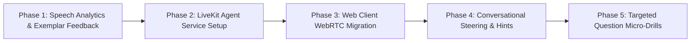

# V1 Interview Architecture & Implementation Plan

Version: 1.0  
Status: Active Blueprint for Audio-First Production Upgrade  

---

# 1. Executive Summary & Vision

The objective of **Interviewer AI V1** is to create the most realistic, high-impact, audio-first interview preparation platform available. 

Real hiring interviews are high-stakes, real-time conversations. To prepare candidates effectively, an interview simulation cannot feel like talking to a lagging chatbot or dealing with audio glitches. It must replicate the pacing, conversational pressure, interruption dynamics, and nuanced feedback of an experienced hiring manager.

For Version 1, the platform focuses strictly on **Audio-Only Excellence**. Multi-modal features (collaborative coding editors and video feeds) are deliberately deferred to V2 to ensure the foundational voice experience, conversational intelligence, and pedagogical coaching loop are hardened to production standards.

---

# 2. System Architecture: Target V1 Topology

The V1 system shifts from raw TCP WebSockets to an industrial-grade **WebRTC media infrastructure** powered by **LiveKit**, while maintaining our server-authoritative state machine, database persistence, and career analytics.

```text
┌────────────────────────────────────────────────────────────────────────┐
│ BROWSER (Candidate Client)                                             │
│  • WebRTC Client: Native Opus audio track (24–32 kbps adaptive)        │
│  • Hardware-accelerated browser AEC (Acoustic Echo Cancellation)       │
│  • Ambient 3D Voice Orb / Visualizer (Listening, Thinking, Speaking)   │
│  • Real-time HUD: Pacing meter, timer, hint request, emergency text    │
└────────────────────────────────────┬───────────────────────────────────┘
                                     │ WebRTC (UDP / DTLS / SRTP)
                                     ▼
┌────────────────────────────────────────────────────────────────────────┐
│ LIVEKIT SFU (Media Server - Cloud or Docker Container)                 │
│  • Sub-50ms media routing, dynamic jitter buffering                    │
│  • Packet Loss Concealment (PLC), Forward Error Correction (FEC)       │
│  • Global edge traversal & automatic NAT / ICE handling                │
└────────────────────────────────────┬───────────────────────────────────┘
                                     │ Low-latency internal transport
                                     ▼
┌────────────────────────────────────────────────────────────────────────┐
│ LIVEKIT AGENT RUNTIME (Autonomous Voice Interviewer Worker)            │
│  ┌──────────────────────────────────────────────────────────────────┐  │
│  │ Conversational Pipeline:                                         │  │
│  │  1. VAD: Silero VAD (neural speech detection & intonation sense) │  │
│  │  2. STT: Deepgram Nova-3 (real-time streaming transcription)     │  │
│  │  3. LLM: Gemini 2.0 Flash (context pack, BYO key, streaming TTFT)│  │
│  │  4. TTS: Cartesia Sonic / Deepgram Aura-2 (~90ms first-byte TTS) │  │
│  │                                                                  │  │
│  │ Conversational Steering:                                         │  │
│  │  • Active Monologue Interruptor (intervenes if candidate >90s)   │  │
│  │  • Calibrated Hint Engine (responds to "Can I get a hint?")      │  │
│  │  • Sub-150ms Barge-In (halts TTS on candidate speech onset)      │  │
│  └──────────────────────────────────────────────────────────────────┘  │
└────────────────────────────────────┬───────────────────────────────────┘
                                     │ REST / Internal Webhook Sync
                                     ▼
┌────────────────────────────────────────────────────────────────────────┐
│ FASTIFY BACKEND API (Platform Authority)                               │
│  • Session Authorization: Issues signed LiveKit Room Tokens            │
│  • Multi-Instance Leases: VoiceSessionRegistry (Redis locks)           │
│  • Concurrency Caps: VoiceConcurrencyLimiter (100 concurrent cap)      │
│  • Data Persistence: Appends ConversationTurn & InterviewMemory        │
│  • Asynchronous Evaluation: Post-interview Report & Skill Analysis     │
│  • Billing & Entitlements: Paddle integration                          │
└────────────────────────────────────┬───────────────────────────────────┘
                                     │
                                     ▼
┌────────────────────────────────────────────────────────────────────────┐
│ PERSISTENCE & JOBS                                                     │
│  • PostgreSQL (Prisma ORM): Immutable turns, rubrics, readiness scores │
│  • Redis: Rate limits, pub/sub event bus, BullMQ background queues     │
└────────────────────────────────────────────────────────────────────────┘
```

---

# 3. Core Architectural Upgrades

### A. Media Transport: Moving from WebSockets to WebRTC (LiveKit)

| Characteristic | Previous WebSocket Pipeline | V1 LiveKit WebRTC Pipeline |
| :--- | :--- | :--- |
| **Network Protocol** | TCP WebSocket | **UDP WebRTC** |
| **Resilience to Packet Loss** | TCP Head-of-Line blocking (freezes, audio drops, jitter) | **Opus Packet Loss Concealment (PLC)** (smooth audio on lossy Wi-Fi) |
| **Audio Bandwidth** | Uncompressed 16/24 kHz PCM (~384 kbps) | **Voice-Optimized Opus (24–32 kbps)** |
| **Echo Cancellation** | Ad-hoc software muting windows & energy heuristics | **Hardware-accelerated C++ browser AEC** (Headphones optional!) |
| **Conversational Latency** | ~1.8s – 2.5s end-to-end | **~600ms – 800ms end-to-end** |

### B. Turn-Taking: Neural VAD vs. Fixed Silence Timers
* **The Problem**: Fixed silence timers (e.g., 500 ms) cut candidates off when pausing to think (*"I would approach this by... [pause]... creating an index"*).
* **The Upgrade**: **Silero VAD** in the LiveKit agent worker analyzes acoustic pitch and inflection. If the candidate pauses with a rising pitch or vocalized hesitation (*"um"*, *"hmm"*), the agent waits. If pitch drops indicating turn completion, the agent responds within 600 ms.

### C. Active Conversational Steering (Real Interviewer Dynamics)
* **Monologue Guard**: Real interviewers do not let candidates ramble uninterrupted for 4 minutes. If a candidate speaks for > 90 seconds without checking in, the agent politely interjects:
  > *"Excuse me for jumping in—I want to make sure we cover scaling before our time is up. How would you handle cross-region replication?"*
* **Candidate Hint Requests**: Candidates can ask:
  > *"I'm stuck between a distributed lock and optimistic concurrency; can I get a quick hint?"*
  The agent provides a targeted nudge, logs the hint in `InterviewMemory`, and factors it into the final score.

---

# 4. Pedagogical Coaching Engine (How Candidates Improve)

A realistic interview must provide deep, actionable feedback that helps candidates fix bad habits before their real hiring rounds.

```text
┌─────────────────────────────────────────────────────────────────────────┐
│ V1 CANDIDATE FEEDBACK REPORT & COACHING HUD                             │
├─────────────────────────────────────────────────────────────────────────┤
│ 1. SPEECH DELIVERY ANALYTICS                                            │
│    • Pacing: 142 WPM [Optimal: 130–160 WPM]                             │
│    • Filler Word Frequency:                                             │
│      - "like": 14 instances | "um / uh": 8 instances | "you know": 3    │
│    • Talk-to-Listen Ratio: 78% candidate / 22% interviewer              │
│    • Latency to Respond: 1.8s average pause after question              │
│                                                                         │
│ 2. BEHAVIORAL STAR METHOD BREAKDOWN                                     │
│    • Question 1: "Tell me about a high-severity production outage."      │
│      - Situation (20%): ✅ Clear context & architecture scale           │
│      - Task (15%):      ✅ Ownership clearly stated                     │
│      - Action (45%):    ⚠️ Used "We did" instead of "I decided"         │
│      - Result (20%):    ❌ Missing metrics (revenue/latency impact)     │
│                                                                         │
│ 3. MODEL "EXEMPLAR" REWRITE                                             │
│    • Candidate Response: "We rolled back the release and fixed tests."  │
│    • Exemplar Response:  "I ordered an immediate Canary rollback within │
│      3 minutes, mitigating 99% of customer traffic, then wrote an RCA   │
│      and integration tests preventing recurrence."                      │
│                                                                         │
│ 4. ONE-CLICK "RE-DO" DRILL                                              │
│    [ 🔁 Re-take Question 1 (3-minute focused voice drill) ]             │
└─────────────────────────────────────────────────────────────────────────┘
```

1. **Filler Word & Pacing Analytics**:
   Calculated directly from transcript word timestamps: Words Per Minute (WPM), filler word count (*"like"*, *"um"*, *"you know"*), and monologue alerts.
2. **STAR Method Rubric**:
   Behavioral answers are parsed for Situation, Task, Action, and Result components, flagging missing outcomes or excessive "we" vs. "I".
3. **Exemplar Answers**:
   For any answer scoring under 70, the AI generates a side-by-side model answer showing how a Staff / Senior candidate answers.
4. **Targeted Micro-Drill ("Re-Do" Mode)**:
   A candidate can click **"Re-try Question"** directly from the report to launch an instant 3-minute voice drill on that specific question.

---

# 5. Phased Implementation Roadmap

Follow the execution principles of [`docs/EngineeringPlaybook.md`](./EngineeringPlaybook.md): single objective per PR, zero breaking changes to existing database models, full backward compatibility.



### Phase 1: Speech Delivery Analytics & Exemplar Feedback
* **Goal**: Upgrade the post-interview report with actionable delivery metrics and exemplar rewrites using existing transcript data.
* **Deliverables**:
  - Word timestamp analysis helper in `apps/api/src/modules/reports/`: calculates WPM, filler word frequencies, and hesitation lengths.
  - STAR breakdown and model exemplar rewrite prompts in `packages/prompts/src/reports.ts`.
  - Frontend report review cards displaying speech pacing charts and exemplar comparisons.
* **Exit Criteria**: Reports display WPM, filler word count, and exemplar rewrites for questions scoring < 70%.

### Phase 2: LiveKit Agent Service Setup
* **Goal**: Stand up the LiveKit SFU infrastructure and autonomous Agent Worker.
* **Deliverables**:
  - LiveKit server setup (Docker Compose for local development, LiveKit Cloud for production).
  - New service `apps/agent` using `@livekit/agents`:
    - Deepgram Nova-3 STT plugin.
    - Cartesia Sonic TTS plugin (with Deepgram Aura-2 fallback).
    - Gemini 2.0 Flash LLM reasoning plugin.
    - Silero VAD neural turn detector.
  - `POST /api/v1/interviews/:id/livekit-token` endpoint in Fastify issuing scoped participant JWTs.
* **Exit Criteria**: Agent joins a LiveKit room, transcribes speech, responds with Cartesia voice, and honors barge-in with < 150 ms cutoff.

### Phase 3: Web Client WebRTC Migration
* **Goal**: Replace legacy WebSocket PCM audio capture with the LiveKit WebRTC client.
* **Deliverables**:
  - Replace `ScriptProcessorNode` and `AgentAudioPlayer` in `apps/web/features/conversation/` with `@livekit/components-react`.
  - Enable browser-level Acoustic Echo Cancellation (AEC) and noise suppression.
  - Maintain the existing state machine (`IDLE` $\rightarrow$ `LISTENING` $\rightarrow$ `THINKING` $\rightarrow$ `SPEAKING`) and SSE event compatibility.
  - Wire the 3D voice visualizer to LiveKit track audio energy levels.
* **Exit Criteria**: Candidates can conduct full voice interviews using laptop speakers and mic without headphones, with zero audio echo or feedback loops.

### Phase 4: Active Conversational Steering & Hint System
* **Goal**: Give the interviewer active steering capabilities and hint awareness.
* **Deliverables**:
  - Monologue timer in `apps/agent`: triggers gentle conversational interjection after 90 seconds of continuous user speech.
  - Hint detection: prompts the LLM to provide calibrated hints when asked, tagging the turn as `HINT_PROVIDED` in PostgreSQL.
  - Sync agent turns and settled turns to Fastify API via internal authenticated sync endpoint.
* **Exit Criteria**: Rambling candidates are politely steered; requesting a hint yields a constructive clue and records hint usage in the report.

### Phase 5: Targeted Question Micro-Drills ("Re-Do" Mode)
* **Goal**: Enable instant single-question practice loops directly from the feedback report.
* **Deliverables**:
  - `POST /api/v1/interviews/:id/drills/new`: creates a lightweight 3-minute micro-interview focusing on a specific fumbled question.
  - Frontend "Re-take Question" button launching the micro-drill.
  - Updating candidate `SkillAnalysis` and `ReadinessSnapshot` on drill completion.
* **Exit Criteria**: Candidates can re-attempt a weak question immediately, seeing their score improve on re-evaluation.

---

# 6. Definition of Done & Target Outcome

When the V1 upgrade is complete, the platform will satisfy the following measurable criteria:

| Metric / Capability | Production Target | Verification Method |
| :--- | :--- | :--- |
| **Voice Turn Latency** | ≤ 800 ms p95 (answer complete $\rightarrow$ first audio byte) | Automated synthetic latency harness |
| **Greeting Latency** | ≤ 1.2 s from room connection | Timed client connection logs |
| **Barge-in Stop** | ≤ 150 ms from speech onset | Synthetic speech collision test |
| **Audio Quality & Echo** | Zero audio echo/feedback loops without headphones | Physical laptop speaker/mic test |
| **Turn Detection** | Tolerates 1.2s thinking hesitations without cutting off | Scripted pause test |
| **Speech Analytics** | Accurate WPM, filler word count, and talk-to-listen ratio | Transcript verification fixtures |
| **Exemplar Coaching** | Every score < 70 includes a STAR model rewrite | Automated report schema assertion |
| **Targeted Drill** | Single-click re-try for any question from report | End-to-end Cypress / Playwright test |
| **Multi-Instance Concurrency** | Exactly 1 active audio session per interview, capped at 100 | Concurrency lease integration tests |

---

# 7. Document Governance

This document serves as the architectural contract for the V1 Audio-First upgrade. Any changes to audio transport, AI reasoning models, speech metrics, or coaching workflows must update this specification.
